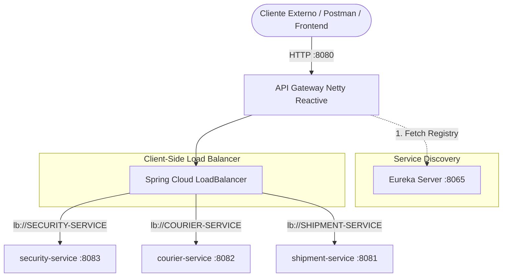
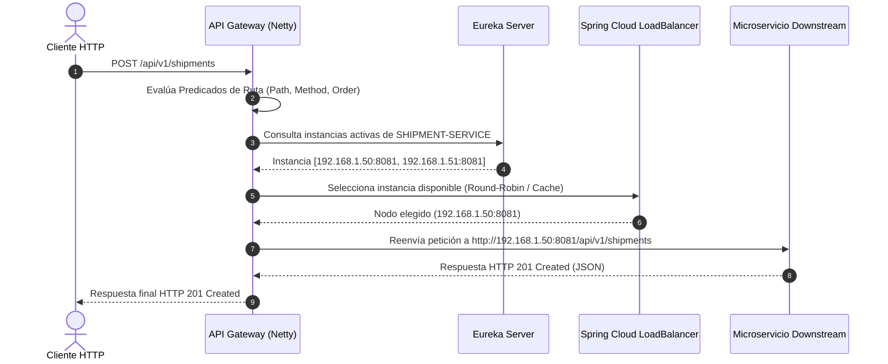

# 📘 Documentación Técnica — Rutas Dinámicas hacia los Microservicios

**Proyecto:** LogiTrack  
**Módulo:** `api-gateway`  
**Autor:** Gonzalo Carrillo (@GonzaCarrillo)  
**Sprint:** Sprint 3  
**Rama:** `feat/s3-81-rutas-dinamicas-microservicios`  
**Relación con Issue:** [[SPRINT 3][GATEWAY] Implementar rutas dinámicas hacia los microservicios #81](https://github.com/Logitrack-Sa/shipment-service/issues/81)  
**Dependencias Previas:** ISSUE 2 (Registro en Eureka) e ISSUE 4 (Módulo API Gateway #80)

---

## 1. Resumen Ejecutivo

En el marco del **Sprint 3**, se implementó el enrutamiento dinámico en **Spring Cloud Gateway** para desacoplar topológicamente el acceso exterior a la plataforma **LogiTrack**, permitiendo que todas las peticiones hacia los microservicios de dominio (`security-service`, `courier-service` y `shipment-service`) se despachen a través del puerto único del Gateway (`8080`) sin requerir conocimiento de direcciones IP físicas ni puertos efímeros.

### Logros Principales:
1. **Resolución Dinámica vía Eureka:** Configuración del esquema reactivo `lb://SERVICE-NAME` aprovechando el cliente Eureka y `Spring Cloud LoadBalancer`.
2. **Compatibilidad Total de Endpoints Existentes:** Soporte para la convención de paths de los controladores existentes (`/api/v1/...`) y retrocompatibilidad para llamadas sin versión (`/api/...`).
3. **Prevención Estricta de Conflictos:** Definición de órdenes de precedencia explícitos (`order`) y predicados de path disjuntos, garantizando que solicitudes hacia `/api/v1/couriers/**` sean atendidas exclusivamente por `courier-service`.
4. **Inspección y Observabilidad:** Exposición del catálogo de rutas dinámicas a través de `RouteLocator` y del endpoint `/actuator/gateway/routes`.
5. **Cobertura de Pruebas Automatizadas:** 13 casos de prueba de integración reactiva en `DynamicRoutingIntegrationTest` y verificación completa con `./mvnw test`.
6. **Validación JavaDoc:** Conformidad estricta con los estándares de documentación de la plataforma (`mvn javadoc:javadoc`).
7. **Colección de Postman:** Exportación de colección completa para verificación manual y automatizada.

---

## 2. Arquitectura de Enrutamiento Dinámico

### 2.1 Topología Perimetral con Eureka y LoadBalancer



### 2.2 Flujo de Resolución de una Solicitud Dinámica



---

## 3. Matriz de Rutas Configuradas y Predicados

A continuación se detalla la configuración de rutas declarada en `application.yml` y centralizada en `config-repo/api-gateway.properties`:

| Ruta ID | Microservicio Destino | URI LoadBalancer | Predicados de Path | Orden | Endpoints Cubiertos |
| :--- | :--- | :--- | :--- | :---: | :--- |
| **`security-service-auth`** | `security-service` | `lb://SECURITY-SERVICE` | `/api/v1/auth/**`<br/>`/api/auth/**` | `100` | • `POST /api/v1/auth/register`<br/>• `POST /api/v1/auth/login`<br/>• `GET /api/v1/auth/me`<br/>• `GET /api/v1/auth/jwks`<br/>• `GET /api/v1/auth/public-key` |
| **`security-service-users`** | `security-service` | `lb://SECURITY-SERVICE` | `/api/v1/users/**`<br/>`/api/users/**` | `110` | • `GET /api/v1/users`<br/>• `POST /api/v1/users`<br/>• `GET /api/v1/users/{id}`<br/>• `PUT/PATCH /api/v1/users/{id}/roles`<br/>• `PUT/PATCH /api/v1/users/{id}/customer-link`<br/>• `PUT/PATCH /api/v1/users/{id}/courier-link` |
| **`courier-service-couriers`** | `courier-service` | `lb://COURIER-SERVICE` | `/api/v1/couriers/**`<br/>`/api/couriers/**` | `200` | • `POST /api/v1/couriers`<br/>• `GET /api/v1/couriers`<br/>• `GET /api/v1/couriers/{id}`<br/>• `PATCH /api/v1/couriers/{id}/status` |
| **`courier-service-internal`** | `courier-service` | `lb://COURIER-SERVICE` | `/api/v1/internal/couriers/**`<br/>`/api/internal/couriers/**` | `210` | • `GET /api/v1/internal/couriers/{id}/status` (contrato de integración entre microservicios) |
| **`shipment-service-shipments`** | `shipment-service` | `lb://SHIPMENT-SERVICE` | `/api/v1/shipments/**`<br/>`/api/shipments/**` | `300` | • `POST /api/v1/shipments`<br/>• `GET /api/v1/shipments`<br/>• `GET /api/v1/shipments/{id}`<br/>• `PATCH /api/v1/shipments/{id}/status`<br/>• `POST /api/v1/shipments/{id}/cancellation`<br/>• `POST /api/v1/shipments/{id}/courier`<br/>• `GET /api/v1/shipments/{id}/history` |
| **`shipment-service-customers`** | `shipment-service` | `lb://SHIPMENT-SERVICE` | `/api/v1/customers/**`<br/>`/api/customers/**` | `310` | • `POST /api/v1/customers`<br/>• `GET /api/v1/customers`<br/>• `GET /api/v1/customers/{id}` |
| **`security-service-openapi`** | `security-service` | `lb://SECURITY-SERVICE` | `/v3/api-docs/security-service` | `400` | Reescribe a `/v3/api-docs` downstream |
| **`courier-service-openapi`** | `courier-service` | `lb://COURIER-SERVICE` | `/v3/api-docs/courier-service` | `410` | Reescribe a `/v3/api-docs` downstream |
| **`shipment-service-openapi`** | `shipment-service` | `lb://SHIPMENT-SERVICE` | `/v3/api-docs/shipment-service` | `420` | Reescribe a `/v3/api-docs` downstream |

---

## 4. Prevención de Conflictos y Desacoplamiento

Una de las exigencias técnicas críticas de la Issue #81 es **"Evitar conflictos entre rutas"**.

### Medidas Implementadas:
1. **Aislamiento por Dominio Funcional:** Cada microservicio gestiona un conjunto de prefijos de recursos unívocos (`auth`, `users`, `couriers`, `shipments`, `customers`).
2. **Prioridad Numérica Explícita (`order`):**
   - Rutas de seguridad: `order: 100` y `110`.
   - Rutas de repartidores: `order: 200` y `210`.
   - Rutas de envíos y clientes: `order: 300` y `310`.
   - Documentación OpenAPI: `order: 400+`.
3. **Resolución de la Ambigüedad Histórica de Couriers:**
   En el Sprint 1 existía un controlador de couriers dentro de `shipment-service`. Al haberse extraído en el Sprint 2 a su propio microservicio (`courier-service`), la asignación de `order: 200` garantiza que cualquier petición a `/api/v1/couriers/**` sea despachada de manera determinística a `lb://COURIER-SERVICE`.
4. **Desacoplamiento Topológico:** No existen direcciones IP fijas ni nombres de host estáticos en la configuración; toda resolución es dinámica a través del registro de Eureka.

---

## 5. Implementación en Código

### 5.1 Dependencia `spring-cloud-starter-loadbalancer` (`pom.xml`)

```xml
<dependency>
    <groupId>org.springframework.cloud</groupId>
    <artifactId>spring-cloud-starter-loadbalancer</artifactId>
</dependency>
```

### 5.2 Constantes y Diagnóstico en `GatewayRoutesConfig.java`

Se crearon identificadores y URIs tipadas con Javadoc exhaustivo:

```java
public static final String SERVICE_SECURITY = "SECURITY-SERVICE";
public static final String URI_SECURITY = "lb://" + SERVICE_SECURITY;

public static final String SERVICE_COURIER = "COURIER-SERVICE";
public static final String URI_COURIER = "lb://" + SERVICE_COURIER;

public static final String SERVICE_SHIPMENT = "SHIPMENT-SERVICE";
public static final String URI_SHIPMENT = "lb://" + SERVICE_SHIPMENT;
```

---

## 6. Pruebas Automatizadas

Se diseñó e implementó la suite `@SpringBootTest` reactiva `DynamicRoutingIntegrationTest` con 13 pruebas organizadas en 5 bloques `@Nested`:

```
[INFO] Running com.logitrack.gateway.ApiGatewayApplicationTests
[INFO] Tests run: 3, Failures: 0, Errors: 0, Skipped: 0 -- in ApiGatewayApplicationTests
[INFO] Running com.logitrack.gateway.DynamicRoutingIntegrationTest
[INFO] Tests run: 2, Failures: 0, Errors: 0, Skipped: 0 -- in 1. Verificación de Identificadores y Unicidad de Rutas
[INFO] Tests run: 4, Failures: 0, Errors: 0, Skipped: 0 -- in 2. Resolución Dinámica hacia Nombres Lógicos de Eureka (lb://...)
[INFO] Tests run: 2, Failures: 0, Errors: 0, Skipped: 0 -- in 3. Prevención de Conflictos y Priorización de Rutas
[INFO] Tests run: 1, Failures: 0, Errors: 0, Skipped: 0 -- in 4. Predicados y Endpoints Existentes de la Plataforma
[INFO] Tests run: 1, Failures: 0, Errors: 0, Skipped: 0 -- in 5. Consulta de Rutas Dinámicas a través de Spring Boot Actuator
[INFO] 
[INFO] Results:
[INFO] Tests run: 13, Failures: 0, Errors: 0, Skipped: 0
[INFO] BUILD SUCCESS
```

---

## 7. Pruebas con Postman

Se construyó el artefacto de pruebas exportable:  
📂 `api-gateway/docs/postman/LogiTrack_Gateway_Dynamic_Routes.postman_collection.json`

### Variables de la Colección:
* `gatewayUrl`: `http://localhost:8080`
* `authToken`: Administrado dinámicamente mediante el script de test del endpoint `/api/v1/auth/login`.
* `courierId`, `shipmentId`, `customerId`: Identificadores UUID preconfigurados para pruebas locales o en staging.

### Carpetas Incluidas:
1. **`01 - Security Service (lb://SECURITY-SERVICE)`** (5 peticiones: registro, login, perfil `auth/me`, JWKS, usuarios).
2. **`02 - Courier Service (lb://COURIER-SERVICE)`** (5 peticiones: creación, listado paginado, detalle, actualización de estado, estado interno mínimo).
3. **`03 - Shipment Service (lb://SHIPMENT-SERVICE)`** (9 peticiones: creación, listado paginado, detalle, asignación de repartidor, máquina de estados, cancelación, historial de auditoría, gestión de clientes).
4. **`04 - API Gateway Actuator & Fallback`** (3 peticiones: `/actuator/health`, `/actuator/gateway/routes`, `/fallback`).

---

## 8. Verificación de Criterios de Aceptación (Issue #81)

| Criterio de Aceptación | Estado | Evidencia de Cumplimiento |
| :--- | :---: | :--- |
| **Las solicitudes llegan al servicio de destino correcto** | ✅ Cumplido | Cada ruta mapea sus predicados específicos a la URI `lb://` del microservicio correspondiente. |
| **El Gateway utiliza Eureka para localizar las instancias** | ✅ Cumplido | Configuración con `@EnableDiscoveryClient`, `spring-cloud-starter-netflix-eureka-client` y `spring-cloud-starter-loadbalancer`. |
| **Las rutas funcionan sin depender de direcciones IP fijas** | ✅ Cumplido | Verificado en `DynamicRoutingIntegrationTest.noMicroserviceRouteShouldUseFixedIpOrHost()`. |
| **Los endpoints existentes continúan funcionando mediante el nuevo punto de entrada** | ✅ Cumplido | Los predicados capturan tanto `/api/v1/...` (endpoints actuales) como `/api/...`, preservando los contratos REST sin modificaciones downstream. |

---

## 9. Comandos de Validación Local

```bash
# Ejecución completa de pruebas automatizadas
./mvnw test -Djava.version=21

# Validación rigurosa de JavaDocs
./mvnw javadoc:javadoc -Djava.version=21
```
