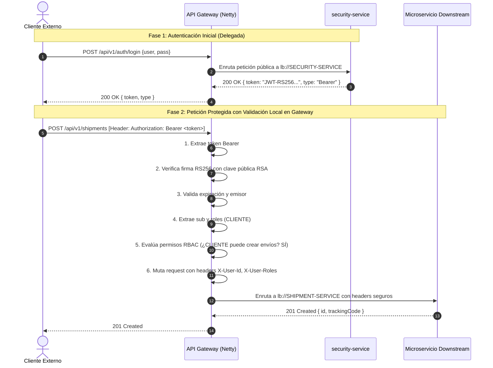
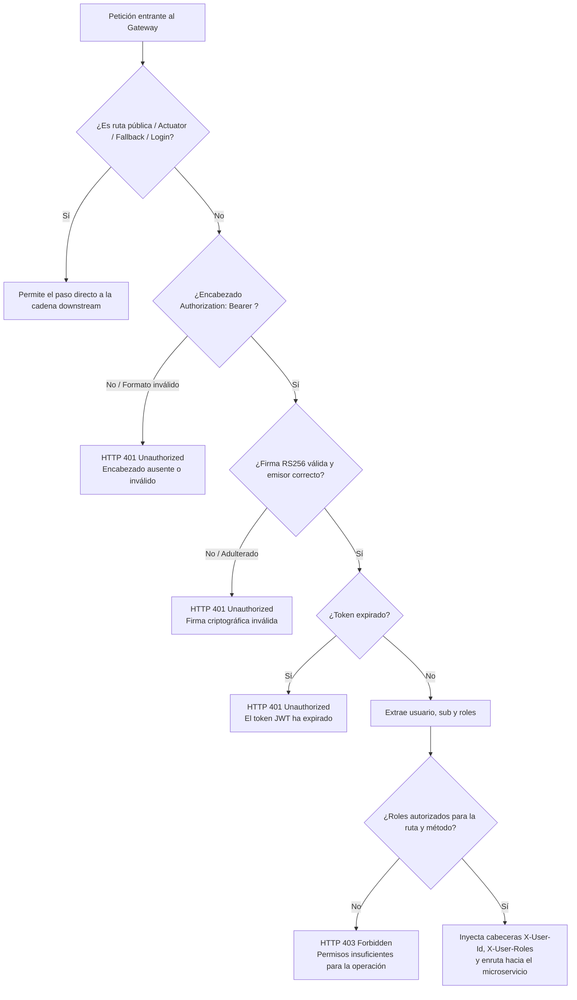

# 📘 Documentación Técnica — Gestión de JWT y Roles desde el API Gateway

**Proyecto:** LogiTrack  
**Módulo:** `api-gateway`  
**Autor:** Gonzalo Carrillo (@GonzaCarrillo)  
**Sprint:** Sprint 3  
**Rama:** `feat/s3-82-gestion-jwt-roles-gateway`  
**Relación con Issue:** [[SPRINT 3][SEGURIDAD] Gestionar JWT y roles desde el API Gateway #82](https://github.com/Logitrack-Sa/shipment-service/issues/82)  
**Dependencias Previas:** ISSUE 4 (Módulo API Gateway #80) e ISSUE 5 (Rutas Dinámicas #81)

---

## 1. Resumen Ejecutivo

En el marco de la Issue **#82**, se implementó el subsistema de **Seguridad Perimetral Reactivo** en el **API Gateway** de LogiTrack. La solución centraliza la interceptación, validación criptográfica de tokens JWT (RS256) y el control de acceso basado en roles (**RBAC**), protegiendo integralmente los microservicios aguas abajo (`shipment-service`, `courier-service` y las rutas administrativas de `security-service`).

### Principios de Diseño Fundamentales:
1. **Autenticación Delegada Inicial:** La obtención de credenciales y emisión del JWT recae exclusivamente en `security-service` (`POST /api/v1/auth/login` y `POST /api/v1/auth/register`), que permanecen como rutas públicas accesibles a través del Gateway.
2. **Validación Criptográfica Descentralizada por Solicitud:** Para evitar cuellos de botella y dependencia circular, el API Gateway **no reenvía cada petición a `security-service`** para verificar el token; en su lugar, valida localmente la firma digital `RS256` utilizando la clave pública RSA (X.509) y verifica la vigencia temporal y el emisor de acuerdo con el diseño de seguridad del Sprint 2.
3. **No Confianza en Roles de Cliente:** Los permisos se derivan estrictamente del claim autenticado `roles` dentro del JWT firmado por el emisor confiable; cualquier intento de manipulación invalida la firma criptográfica.
4. **Matriz RBAC Consistente con Sprint 2:** Reglas claras para los roles `ADMIN`, `CLIENTE` y `REPARTIDOR`, devolviendo `HTTP 401 Unauthorized` ante autenticación fallida y `HTTP 403 Forbidden` ante falta de privilegios.
5. **Privacidad y Trazabilidad:** Prohibición estricta de registrar tokens JWT completos en los logs del sistema.

---

## 2. Arquitectura de Seguridad Perimetral

### 2.1 Flujo de Autenticación vs. Validación Perimetral



### 2.2 Diagrama de Decisión del Filtro Reactivo de Seguridad



---

## 3. Matriz de Control de Acceso por Roles (RBAC)

De acuerdo a las definiciones de dominio del **Sprint 2** y requerimientos de la Issue **#82**:

| Recurso / Ruta | Método | ADMIN | CLIENTE | REPARTIDOR | Acción del Gateway |
| :--- | :---: | :---: | :---: | :---: | :--- |
| `/api/v1/auth/login` | `POST` | Público | Público | Público | Permite sin token |
| `/api/v1/auth/register` | `POST` | Público | Público | Público | Permite sin token |
| `/api/v1/auth/jwks` | `GET` | Público | Público | Público | Permite sin token |
| `/api/v1/auth/public-key` | `GET` | Público | Público | Público | Permite sin token |
| `/api/v1/auth/me` | `GET` | ✅ Permitido | ✅ Permitido | ✅ Permitido | Requiere token válido |
| `/api/v1/users/**` | Todos | ✅ Permitido | ❌ 403 | ❌ 403 | Exclusivo ADMIN |
| `/api/v1/couriers/**` | Todos | ✅ Permitido | ❌ 403 | ❌ 403 | CRUD repartidores: solo ADMIN |
| `/api/v1/internal/couriers/**` | `GET` | ✅ Permitido | ❌ 403 | ✅ Permitido | Estado mínimo repartidor |
| `/api/v1/customers/**` | Todos | ✅ Permitido | ❌ 403 | ❌ 403 | Exclusivo ADMIN |
| `/api/v1/shipments` | `POST` | ✅ Permitido | ✅ Permitido | ❌ 403 | Creación de envíos |
| `/api/v1/shipments/**` | `GET` | ✅ Permitido | ✅ Permitido | ✅ Permitido | Consulta y tracking |
| `/api/v1/shipments/{id}/status` | `PATCH`| ✅ Permitido | ❌ 403 | ✅ Permitido | Transición máquina de estados |
| `/api/v1/shipments/{id}/courier`| `POST` | ✅ Permitido | ❌ 403 | ❌ 403 | Asignación de repartidor |
| `/api/v1/shipments/{id}/cancellation`| `POST`| ✅ Permitido | ❌ 403 | ❌ 403 | Cancelación de envío |
| `/actuator/**`, `/fallback/**` | `GET` | Público | Público | Público | Sin requerimiento de token |

---

## 4. Componentes Técnicos Implementados

El paquete [`com.logitrack.gateway.security`](file:///home/gonzalocar/Escritorio/Ingenieria-Informatica/Arquitecturas/Trabajo%20Final/api-gateway/src/main/java/com/logitrack/gateway/security) concentra la lógica de seguridad:

1. **[`JwtSecurityProperties.java`](file:///home/gonzalocar/Escritorio/Ingenieria-Informatica/Arquitecturas/Trabajo%20Final/api-gateway/src/main/java/com/logitrack/gateway/security/JwtSecurityProperties.java):**
   * Configuración de prefijo `logitrack.security.jwt` (`publicKeyLocation`, `issuer`, `keyId`, `clockSkewSeconds`).
2. **[`RsaPublicKeyProvider.java`](file:///home/gonzalocar/Escritorio/Ingenieria-Informatica/Arquitecturas/Trabajo%20Final/api-gateway/src/main/java/com/logitrack/gateway/security/RsaPublicKeyProvider.java):**
   * Decodifica la clave pública RSA desde formato estándar X.509 PEM (`-----BEGIN PUBLIC KEY-----`).
   * Soporta fallback automático a `classpath:certs/public.pem`, `file:certs/public.pem` y `file:../certs/public.pem`.
3. **[`AuthenticatedUser.java`](file:///home/gonzalocar/Escritorio/Ingenieria-Informatica/Arquitecturas/Trabajo%20Final/api-gateway/src/main/java/com/logitrack/gateway/security/AuthenticatedUser.java):**
   * Modelo inmutable que encapsula `userId` (UUID), `roles` (`Set<String>`), `customerId` y `courierId`.
4. **[`JwtTokenValidator.java`](file:///home/gonzalocar/Escritorio/Ingenieria-Informatica/Arquitecturas/Trabajo%20Final/api-gateway/src/main/java/com/logitrack/gateway/security/JwtTokenValidator.java):**
   * Emplea `com.nimbusds:nimbus-jose-jwt` y `RSASSAVerifier`.
   * Verifica algoritmo `RS256`, firma matemática, vigencia temporal, emisor y extrae los claims validados.
5. **[`SecurityPathMatcher.java`](file:///home/gonzalocar/Escritorio/Ingenieria-Informatica/Arquitecturas/Trabajo%20Final/api-gateway/src/main/java/com/logitrack/gateway/security/SecurityPathMatcher.java):**
   * Clasifica rutas públicas y evalúa la matriz RBAC de acceso de forma no bloqueante.
6. **[`SecurityErrorResponse.java`](file:///home/gonzalocar/Escritorio/Ingenieria-Informatica/Arquitecturas/Trabajo%20Final/api-gateway/src/main/java/com/logitrack/gateway/security/SecurityErrorResponse.java):**
   * Formato homogéneo de respuesta JSON para errores `401 UNAUTHORIZED` y `403 ACCESS_DENIED`:
     ```json
     {
       "timestamp": "2026-11-03T19:12:00Z",
       "status": 401,
       "error": "Unauthorized",
       "code": "UNAUTHORIZED",
       "message": "El token JWT ha expirado.",
       "path": "/api/v1/shipments"
     }
     ```
7. **[`JwtSecurityGlobalFilter.java`](file:///home/gonzalocar/Escritorio/Ingenieria-Informatica/Arquitecturas/Trabajo%20Final/api-gateway/src/main/java/com/logitrack/gateway/security/JwtSecurityGlobalFilter.java):**
   * `GlobalFilter` reactivo con precedencia `-50` que orquesta la verificación antes de encaminar la petición.
   * Inyecta cabeceras de identidad validadas aguas abajo (`X-User-Id`, `X-User-Roles`, etc.).
   * Evita registrar tokens completos en los registros del sistema.

---

## 5. Pruebas Automatizadas

Se diseñó e implementó la suite reactiva [`GatewayJwtSecurityIntegrationTest`](file:///home/gonzalocar/Escritorio/Ingenieria-Informatica/Arquitecturas/Trabajo%20Final/api-gateway/src/test/java/com/logitrack/gateway/GatewayJwtSecurityIntegrationTest.java) con 19 pruebas distribuidas en 4 bloques:

```
[INFO] Running com.logitrack.gateway.GatewayJwtSecurityIntegrationTest
[INFO] Tests run: 5, Failures: 0, Errors: 0, Skipped: 0 -- in 1. Rutas Públicas (Sin Requerimiento de Autenticación)
[INFO] Tests run: 5, Failures: 0, Errors: 0, Skipped: 0 -- in 2. Autenticación Fallida: Token Ausente o Inválido (HTTP 401)
[INFO] Tests run: 6, Failures: 0, Errors: 0, Skipped: 0 -- in 3. Control de Acceso por Roles: Denegación de Permisos (HTTP 403)
[INFO] Tests run: 3, Failures: 0, Errors: 0, Skipped: 0 -- in 4. Control de Acceso por Roles: Autorización Exitosa
[INFO] 
[INFO] Results:
[INFO] Tests run: 32, Failures: 0, Errors: 0, Skipped: 0
[INFO] BUILD SUCCESS
```

Las 32 pruebas del proyecto (`ApiGatewayApplicationTests` + `DynamicRoutingIntegrationTest` + `GatewayJwtSecurityIntegrationTest`) pasaron exitosamente.

---

## 6. Verificación de Criterios de Aceptación (Issue #82)

| Criterio de Aceptación | Estado | Evidencia de Cumplimiento |
| :--- | :---: | :--- |
| **Las rutas públicas de autenticación continúan funcionando** | ✅ Cumplido | `login`, `register`, `jwks` y `public-key` son identificadas por `SecurityPathMatcher.isPublic()` y responden sin exigir token. |
| **Las solicitudes protegidas sin un token válido son rechazadas** | ✅ Cumplido | Peticiones sin token, con esquema erróneo, token expirado, malformado o con firma adulterada devuelven HTTP 401 estructurado. |
| **Los roles se verifican de manera consistente** | ✅ Cumplido | Los roles son extraídos criptográficamente del claim `roles` firmado por `security-service`; no se confía en parámetros enviados por el cliente. |
| **Los usuarios sin permisos reciben una respuesta HTTP 403 cuando corresponda** | ✅ Cumplido | Verificado en 6 escenarios de denegación (ej. CLIENTE accediendo a usuarios, REPARTIDOR intentando crear envíos, etc.). |
| **El comportamiento es compatible con los endpoints y roles del Sprint 2** | ✅ Cumplido | Matriz de permisos idéntica al contrato unificado del Sprint 2 (`CONTRATOS.md`). |

---

## 7. Comandos de Verificación

```bash
# Ejecución completa de pruebas automatizadas
./mvnw test -Djava.version=21

# Validación rigurosa de JavaDocs
./mvnw javadoc:javadoc -Djava.version=21
```
