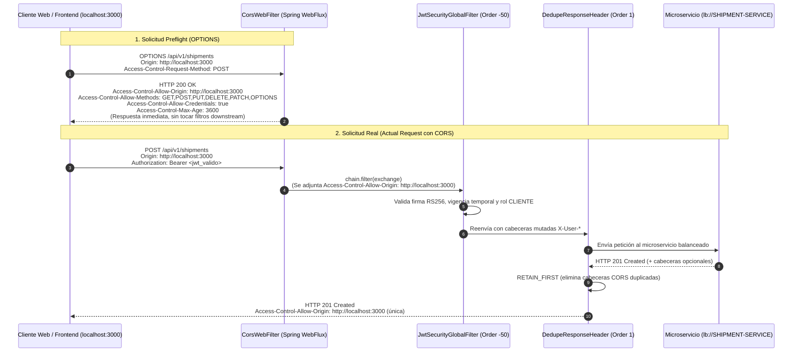

# [SPRINT 3][GATEWAY] Configurar CORS y centralizar propiedades (#83)

| Campo | Detalle |
|---|---|
| **Issue GitHub** | [#83](https://github.com/Logitrack-Sa/shipment-service/issues/83) |
| **Título** | `[SPRINT 3][GATEWAY] Configurar CORS y centralizar propiedades` |
| **Responsable** | `@GonzaCarrillo` |
| **Estado** | `CLOSED` / `IMPLEMENTED` |
| **Rama Git** | `feat/s3-83-configurar-cors-propiedades` (creada a partir de `develop`) |
| **Repositorio principal** | `api-gateway` |
| **Repositorios impactados** | `config-repo`, `config-server` |
| **Dependencias** | ISSUE 4 (Módulo API Gateway) e ISSUE 5 (Rutas dinámicas) |

---

## 1. Descripción y Objetivos

La presente implementación centraliza las políticas de **Cross-Origin Resource Sharing (CORS)** y las propiedades de configuración operativa del **API Gateway** en la arquitectura de microservicios de **LogiTrack**.

### Objetivos Principales:
1. **Centralización perimetral de CORS:** Resolver el intercambio de recursos de origen cruzado exclusivamente en el API Gateway, evitando configuraciones dispersas o duplicadas en los microservicios downstream (`shipment-service`, `courier-service`, `security-service`).
2. **Soporte robusto para Frontend:** Permitir únicamente los orígenes autorizados correspondientes a las interfaces web del proyecto (React en `localhost:3000`, Vite en `localhost:5173`, Angular en `localhost:4200`, desarrollo local en `localhost:8080` y dominios seguros de producción).
3. **Manejo transparente de solicitudes preflight (`OPTIONS`):** Garantizar que las solicitudes preflight `OPTIONS` del navegador sean interceptadas de inmediato y respondidas con `200 OK` y cabeceras `Access-Control-Allow-*` válidas, sin requerir credenciales ni ser bloqueadas por el filtro global de autenticación JWT.
4. **Prevención de respuestas CORS duplicadas:** Integrar el filtro `DedupeResponseHeader` en el Gateway para depurar cualquier cabecera `Access-Control-Allow-*` que eventualmente intente emitir un servicio aguas abajo, impidiendo errores de tipo *"Multiple Access-Control-Allow-Origin headers"* en los navegadores.
5. **Centralización en Config Server (`config-repo`):** Externalizar las propiedades base y los perfiles `dev` y `prod` de `api-gateway` en el repositorio Git versionado de configuraciones.

---

## 2. Arquitectura de CORS Reactivo y Centralización

El API Gateway opera de forma reactiva no bloqueante mediante **Spring WebFlux**. Para evitar los inconvenientes clásicos de los filtros Servlet tradicionales, se utiliza un `CorsWebFilter` configurado a nivel perimetral con alta prioridad (`Ordered.HIGHEST_PRECEDENCE`), acompañado de un filtro `DedupeResponseHeader` registrado en `default-filters`.



---

## 3. Matriz de Configuración CORS y Perfiles

### 3.1 Propiedades Externalizadas (`CorsProperties`)

Se implementó la clase de configuración tipada [`CorsProperties`](file:///home/gonzalocar/Escritorio/Ingenieria-Informatica/Arquitecturas/Trabajo Final/api-gateway/src/main/java/com/logitrack/gateway/config/CorsProperties.java) vinculada al prefijo `logitrack.gateway.cors`:

| Propiedad | Tipo | Valor Predeterminado | Descripción |
|---|---|---|---|
| `enabled` | `boolean` | `true` | Interruptor perimetral de CORS. |
| `allowed-origins` | `List<String>` | `http://localhost:3000`, `http://localhost:5173`, `http://localhost:4200`, `http://localhost:8080`, `http://127.0.0.1:3000`, `http://127.0.0.1:5173` | Orígenes web explícitamente autorizados. |
| `allowed-methods` | `List<String>` | `GET`, `POST`, `PUT`, `DELETE`, `PATCH`, `OPTIONS` | Métodos HTTP permitidos en peticiones cruzadas. |
| `allowed-headers` | `List<String>` | `Authorization`, `Content-Type`, `Accept`, `Origin`, `X-Requested-With`, `Access-Control-Request-Method`, `Access-Control-Request-Headers` | Encabezados aceptados en las solicitudes de clientes. |
| `exposed-headers` | `List<String>` | `Authorization`, `Content-Disposition`, `X-User-Id`, `X-User-Roles` | Encabezados legibles por el cliente web frontend. |
| `allow-credentials` | `boolean` | `true` | Habilita transmisión de credenciales y cabecera `Authorization`. |
| `max-age` | `long` | `3600` | Segundos de expiración en caché local de preflight `OPTIONS` (1 hora). |

### 3.2 Diferenciación de Entornos (`dev` vs `prod`)

* **Perfil `dev` (`api-gateway-dev.properties`):**
  * Habilita los orígenes de desarrollo: React (`:3000`), Vite (`:5173`), Angular (`:4200`), Gateway (`:8080`) y loopbacks `127.0.0.1`.
  * Logging en modo `DEBUG` para auditoría y resolución de peticiones CORS.
  * Eureka URL en `http://localhost:8065/eureka/`.
* **Perfil `prod` (`api-gateway-prod.properties`):**
  * Restringe orígenes a dominios seguros de LogiTrack: `https://logitrack.com`, `https://app.logitrack.com`, `https://admin.logitrack.com`.
  * Logging en modo `INFO` para rendimiento y privacidad.
  * Eureka URL en `http://eureka-server:8065/eureka/`.

---

## 4. Prevención de Duplicación de Cabeceras CORS

Para dar cumplimiento estricto a las tareas de la Issue:
* *"Evitar duplicar políticas de CORS en los microservicios downstream."*
* *"Evitar configuraciones que provoquen respuestas CORS duplicadas."*

Se adoptaron dos mecanismos complementarios:
1. **Regla de oro de diseño:** No definir simultáneamente `spring.cloud.gateway.globalcors` y `@Bean CorsWebFilter`. Se emplea `CorsWebFilter` reactivo centralizado gestionado por `CorsConfig`, garantizando un único punto de generación de cabeceras en el Gateway.
2. **Filtro `DedupeResponseHeader`:** Se configuró en `default-filters` de Spring Cloud Gateway:
   ```yaml
   spring:
     cloud:
       gateway:
         default-filters:
           - DedupeResponseHeader=Access-Control-Allow-Origin Access-Control-Allow-Credentials Access-Control-Allow-Methods Access-Control-Allow-Headers, RETAIN_FIRST
   ```
   En caso de que un servicio downstream intente emitir cabeceras `Access-Control-Allow-*`, el Gateway retiene la primera (emitida perimetralmente) y descarta las subsiguientes.

---

## 5. Archivos Creados y Modificados

### 5.1 Repositorio `api-gateway`
* [`com.logitrack.gateway.config.CorsProperties`](file:///home/gonzalocar/Escritorio/Ingenieria-Informatica/Arquitecturas/Trabajo Final/api-gateway/src/main/java/com/logitrack/gateway/config/CorsProperties.java): Clase de propiedades externalizadas de CORS con JavaDocs completos.
* [`com.logitrack.gateway.config.CorsConfig`](file:///home/gonzalocar/Escritorio/Ingenieria-Informatica/Arquitecturas/Trabajo Final/api-gateway/src/main/java/com/logitrack/gateway/config/CorsConfig.java): Configuración del bean `CorsWebFilter` vinculada a `CorsProperties`.
* [`src/main/resources/application.yml`](file:///home/gonzalocar/Escritorio/Ingenieria-Informatica/Arquitecturas/Trabajo Final/api-gateway/src/main/resources/application.yml): Declaración de `DedupeResponseHeader` y bloque `logitrack.gateway.cors`.
* [`src/test/resources/application-test.yml`](file:///home/gonzalocar/Escritorio/Ingenieria-Informatica/Arquitecturas/Trabajo Final/api-gateway/src/test/resources/application-test.yml): Perfil de prueba con configuración idéntica para validación local.
* [`com.logitrack.gateway.GatewayCorsIntegrationTest`](file:///home/gonzalocar/Escritorio/Ingenieria-Informatica/Arquitecturas/Trabajo Final/api-gateway/src/test/java/com/logitrack/gateway/GatewayCorsIntegrationTest.java): Suite de 9 pruebas de integración reactivas.

### 5.2 Repositorio `config-repo`
* `api-gateway.properties`: Archivo base versionado para el API Gateway con rutas dinámicas, `default-filters` y propiedades de CORS y JWT.
* `api-gateway-dev.properties`: Override de orígenes CORS para desarrollo local y Eureka localhost.
* `api-gateway-prod.properties`: Override de orígenes CORS restringidos a dominios seguros de producción.
* `tests/test_configuration.py`: Prueba automatizada de contrato que valida los perfiles `api-gateway` y las variables de entorno.
* `README.md`: Documentación del contrato del API Gateway en la tabla general de servicios.

### 5.3 Repositorio `config-server`
* `src/main/resources/application.yaml`: Registro de `gateway` en los repositorios de salud monitoreados por Config Server (`health.repositories.gateway`).

---

## 6. Verificación y Resultados de Pruebas

### 6.1 Pruebas de Integración en `api-gateway`
La suite [`GatewayCorsIntegrationTest`](file:///home/gonzalocar/Escritorio/Ingenieria-Informatica/Arquitecturas/Trabajo Final/api-gateway/src/test/java/com/logitrack/gateway/GatewayCorsIntegrationTest.java) cubre los siguientes escenarios:
1. `OPTIONS /api/v1/shipments` con `Origin: http://localhost:3000` -> Retorna `200 OK`, `Access-Control-Allow-Origin: http://localhost:3000`, métodos, cabeceras y `max-age: 3600`. No requiere token.
2. `OPTIONS /api/v1/couriers` con `Origin: http://localhost:5173` (Vite) -> Retorna `200 OK` y cabeceras de concesión.
3. `OPTIONS /api/v1/shipments` con origen malicioso -> Es rechazada sin cabeceras `Access-Control-Allow-Origin`.
4. `GET /actuator/health` con `Origin: http://localhost:3000` -> Retorna `200 OK` con cabecera de origen concedido.
5. `GET /actuator/health` con origen no autorizado -> Es rechazada con `403 Forbidden` sin cabeceras CORS.
6. `POST /api/v1/shipments` sin token desde origen autorizado -> Retorna `401 Unauthorized` preservando las cabeceras CORS para que el frontend pueda interpretar el mensaje de error.
7. `GET /api/v1/shipments` con token válido desde origen autorizado -> Solicitud autorizada con cabeceras CORS.
8. Validación de enlace de `CorsProperties`.
9. Verificación de presencia del filtro `DedupeResponseHeader` en `default-filters`.

### 6.2 Pruebas en `config-repo`
Ejecución de `python3 -m unittest discover -s tests -v`: **7 pruebas superadas exitosamente (OK)**, incluyendo `test_api_gateway_configuration_and_cors`.

---

## 7. Criterios de Aceptación Satisfechos

* [x] **El Gateway obtiene su configuración desde Config Server:** Archivos `api-gateway.properties`, `api-gateway-dev.properties` y `api-gateway-prod.properties` incorporados a `config-repo` y validados en `config-server`.
* [x] **Los orígenes autorizados funcionan correctamente:** Verificado tanto para React (`:3000`), Vite (`:5173`), Angular (`:4200`) y dominios seguros de producción.
* [x] **Los encabezados y métodos necesarios están habilitados:** Se autorizan `GET`, `POST`, `PUT`, `DELETE`, `PATCH`, `OPTIONS` y las cabeceras de autorización y contenido requeridas.
* [x] **Las solicitudes preflight no son bloqueadas indebidamente:** Las peticiones `OPTIONS` son atendidas por `CorsWebFilter` y admitidas por `SecurityPathMatcher` sin requerir autenticación.
* [x] **Sin duplicación de cabeceras CORS:** Centralización perimetral única respaldada por `DedupeResponseHeader`.
